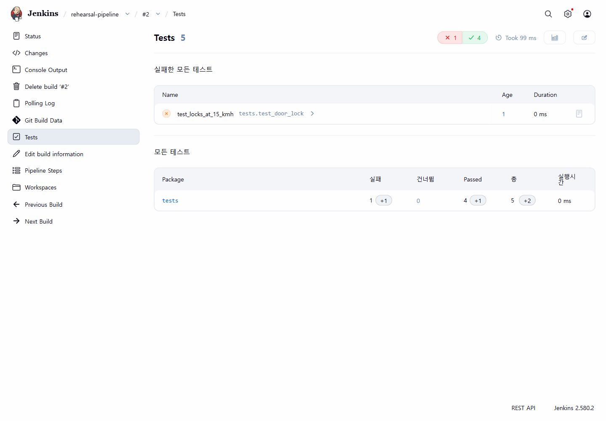
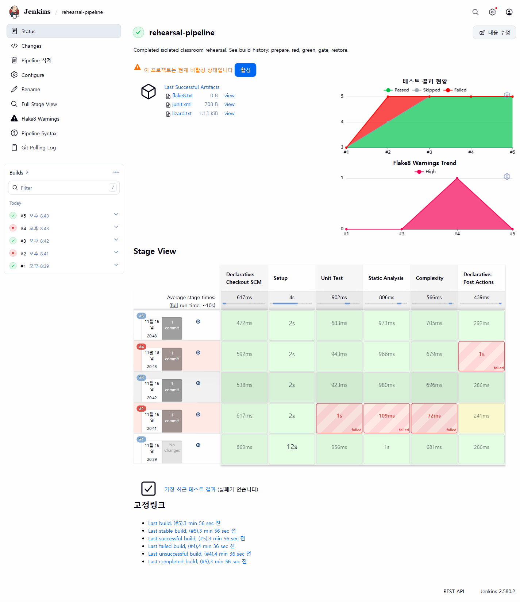
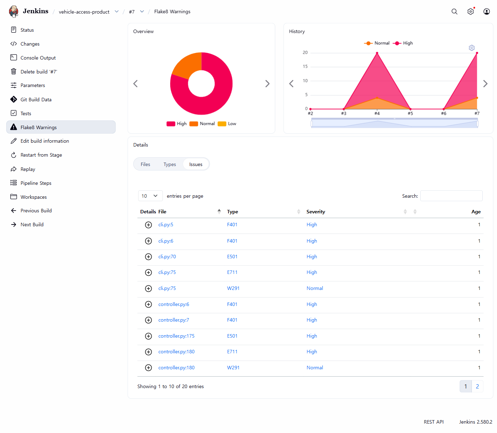

# 검증 기록 — 2026-11-16

Windows에서 Jenkins를 **LocalService Windows 서비스**로 실제 실행하여 검증했습니다.
신규 공개 저장소를 직접 체크아웃한 정상 빌드와, 원본을 보존한 실습 복제본의 실패/복구를 구분했습니다.
검증 코드 기준은 `ce4e0279180e99c5a51cf75e1d4b38361a9cbacc`입니다.
이후 문서·증거 파일을 추가한 커밋의 GitHub Actions 결과는 저장소 Actions 탭에서 확인할 수 있습니다.

> 2026-11-17 변경: 수업용 경고 예제 `doorlock/door_warning.py`를 추가했습니다. 아래 기본 실습 기록의
> '경고 0건', '복구 SUCCESS'는 그 전 코드 기준입니다. 새 기대 결과(Flake8 경고 5건, Lizard 초과 1건)는
> `scripts/check_classroom_demo.py`가 GitHub Actions에서 확인합니다. Jenkins 재검증은 하지 않았습니다.

## 환경과 도구

| 항목 | 실제 확인 |
|---|---|
| Python | 3.15.2, 기본 3개 / 제품 106개 테스트 통과 |
| pytest / Flake8 / Lizard | 9.2.0 / 7.5.0 / 1.26.0 |
| 제품 커버리지 | 구문 154/154, 분기 40/40, 모두 100% |
| Java | Eclipse Temurin JDK 25.0.5+8 |
| Jenkins | LTS 2.580.2, Windows 서비스 자동 시작, `NT AUTHORITY\LocalService` |
| Jenkins 주소 | 로컬 PC의 `http://127.0.0.1:8080/` |
| 플러그인 | 활성 78개, 로딩 실패 0개. 직접 의존성 6개와 전체 버전 잠금 파일 제공 |
| Doxygen | 1.18.0, `doxygen Doxyfile` 종료 코드 0, 경고 없음, HTML 생성 확인 |

직접 의존성은 Git, JUnit, Warnings Next Generation, Pipeline, Stage View, Timestamper입니다.
실제 전체 버전과 SHA-256은 [plugins.json](evidence/plugins.json), 설치 버전 목록은
[plugins.lock.txt](../jenkins/plugins.lock.txt)에 남겼습니다.

## 기본 실습 — Freestyle과 Pipeline 각각 검증

다른 계정의 Fork 생성 자체는 수행하지 않았습니다. 원본은 public이며 Fork 허용을 확인했고,
새 Clone과 GitHub 제공 새 CI 작업 폴더에서 설치·실행을 검증했습니다.
수강자는 원본 소유자와 다른 자신의 GitHub 계정에서 Fork합니다.

정답 변경이 공개 main에 섞이지 않도록 별도의 로컬 Git 원격 저장소를 사용했습니다.
각 단계는 **수정 → 커밋 → 해당 원격에 Push → 실제 SCM polling → 자동 빌드**로 실행했고,
Red 이후 빌드의 원인에 `SCMTriggerCause`가 기록된 것을 확인했습니다.
로컬 체크아웃을 위한 임시 허용 설정은 종료 후 해제했습니다.
리허설 Job은 결과 보존을 위해 비활성화했으며, 공개 저장소를 사용하는 정상 Job은 활성 상태입니다.

| 단계 | Freestyle Job / 빌드 | Pipeline Job / 빌드 | 테스트 | 경고 | 실제 결과 |
|---|---|---|---|---|---|
| 준비 | rehearsal-freestyle #1 | rehearsal-pipeline #1 | 3 통과 | 0 | SUCCESS |
| Red | rehearsal-freestyle #2 | rehearsal-pipeline #2 | 1 실패, 4 통과 | 분석 단계 생략 | FAILURE |
| Green | rehearsal-freestyle #3 | rehearsal-pipeline #3 | 5 통과 | 0 | SUCCESS |
| Gate | rehearsal-freestyle #4 | rehearsal-pipeline #4 | 5 통과 | F401 1 | FAILURE |
| 복구 | rehearsal-freestyle #5 | rehearsal-pipeline #5 | 5 통과 | 0 | SUCCESS |

Red에서 `test_locks_at_15_kmh`의 `assert False is True`를 JUnit과 콘솔에서 확인했습니다.
Pipeline은 뒤 분석·복잡도 단계를 생략해도 JUnit을 게시했습니다.
Gate에서는 `TOTAL=1`, 임계값 1, Quality Gate 실패를 Warnings NG API와 콘솔에서 확인했습니다.
Freestyle의 Red 빌드에서 게시기가 빈 분석 결과를 남기더라도 분석 실행으로 간주하지 않았습니다.

## 확장 제품 — 최종 소스에 대한 세 시나리오

Job 이름은 `vehicle-access-product`입니다. 아래 빌드는 모두 검증 코드 커밋을 체크아웃했습니다.
그 이전의 초기 설정·수정 전 시연 빌드는 완료 판정에 사용하지 않았습니다.

| 빌드 | SCENARIO | 테스트 | 정적 분석 / 복잡도 | 실제 결과 |
|---|---|---|---|---|
| #7 | warnings | 106 통과 | F401 8, E501 4, E711 4, W291 4 = 20건. Lizard 통과 | FAILURE |
| #8 | complexity | 106 통과 | Flake8 0건, 진단 라우팅 함수 CCN 13 → Lizard 종료 코드 1 | FAILURE |
| #9 | clean | 106 통과, 커버리지 100% | Flake8 0건, 복잡도 기준 초과 0건 | SUCCESS |

Warnings NG의 경고 목록·규칙별/파일별 분류·추이 그래프와 실제 소스 행을 브라우저에서 확인했습니다.
보고서에 분석 대상의 절대 경로를 기록하여, 경고 주입 복제본을 원본 소스와 혼동하지 않도록 했습니다.
경고 시연 후 정상 빌드가 복제본을 지운 뒤에도 이전 경고의 실제 소스가 보존되는 것을 확인했습니다.

[경고의 실제 소스 행 화면](evidence/jenkins-warning-source.png)

## 재시작·공개·다른 환경

* Jenkins 서비스를 재시작한 뒤 5개 Job의 빌드 번호/결과, Red JUnit 실패, 20건 경고 보고서가 보존됨을 확인했습니다.
* 공개 main을 사용하는 `door-lock-freestyle`, `door-lock-pipeline`, 제품 Job의 정상 빌드를 확인했습니다.
* GitHub Actions는 Windows/Linux × Python 3.12/3.14/3.15의 6개 작업에서 설치, 기본/제품 테스트,
  커버리지, Flake8, Lizard를 통과했습니다.
  [코드 기준 검증 실행](https://github.com/SyneticsCorp/door-lock-ci/actions/runs/43860774895)
* 공개 파일 검사와 전체 Git 이력에서 강의자료·설치물·인증 정보가 포함되지 않았음을 확인합니다.
  실행 결과와 Jenkins Home은 Git 추적 대상이 아닙니다. 이 문서의 화면은 신규 검증 캡처입니다.
* GitLab CI는 교재의 비교·이식용 파일을 제공하며 실제 GitLab 서버에서는 실행하지 않았습니다.

[빌드·커밋·게이트별 구조화 검증 기록](evidence/validation.json)

이 결과는 명시한 코드와 도구 환경의 교육 실습 재현 기록입니다.
